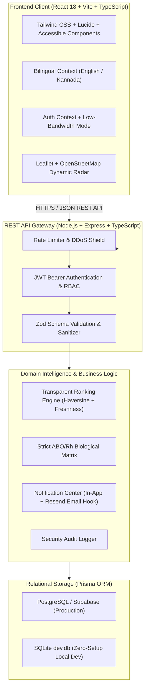
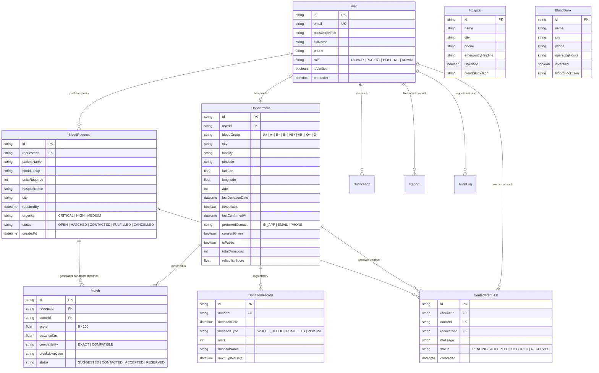

# LifeLink – Smart Blood Donor Network

**LifeLink** is a full-stack, cloud-deployable healthcare application connecting blood donors, patients, hospitals, and blood banks in real time. It replaces fragmented social media appeals with an explainable AI-driven candidate ranking engine, strictly enforced ABO/Rh biological compatibility, anonymous privacy-first contact requests, and real-time emergency radius radars.

---

## 🌟 Key Engineering Highlights

1. **Explainable AI Multi-Factor Ranking Service (0–100 Score)**:
   - **Biological Compatibility Gate**: Strict ABO/Rh antigen rule filter (0 score for non-compatible matches).
   - **Haversine Great-Circle Proximity (0–40 pts)**: Spherical distance estimation without exposing donor GPS.
   - **Live Availability Status (0–25 pts)**: Active donor self-commitment flag.
   - **Profile Confirmation Freshness (0–20 pts)**: Recency of donor check-in.
   - **Response Reliability Rate (0–15 pts)**: Historical commitment fulfillment ratio.
2. **Anonymous Contact Outreach**:
   - Requesters dispatch emergency requests without exposing personal telephone numbers or private home addresses.
3. **Emergency Match Radar & Expiry**:
   - Live interactive radar displaying nearby candidate clusters with countdown timers, rate limiting, and duplicate request prevention.
4. **All Eight Blood Groups Supported**:
   - High-contrast, accessible badges for `A+`, `A-`, `B+`, `B-`, `AB+`, `AB-`, `O+`, `O-`, complete with clinical pathologist cross-matching disclaimers.
5. **Bilingual English & Kannada Interface**:
   - Clean translation dictionary for English and Kannada (`ಕನ್ನಡ`).
6. **Zero-Setup Local Mode & Production PostgreSQL**:
   - Runs instantly with zero external dependencies via SQLite / Prisma ORM in development, with drop-in configuration for Supabase PostgreSQL on Render / Railway / Vercel.

---

## 🏗️ System Architecture



---

## 🗄️ Database Entity-Relationship Diagram



---

## 🔑 Pre-Seeded Evaluation Accounts (Marked [DEMO])

The development database is seeded with realistic demonstration accounts:

| Role | Email Address | Password | Features Accessible |
| :--- | :--- | :--- | :--- |
| **System Admin** | `admin@lifelink.demo` | `DemoAdmin@123` | Governance Dashboard, Moderation, Audit Logs, Partner Verification |
| **Donor (O-)** | `donor.o@lifelink.demo` | `DemoDonor@123` | Availability switch, incoming requests, donation history |
| **Donor (O+)** | `donor.o_pos@lifelink.demo` | `DemoDonor@123` | Availability switch, incoming requests, donation history |
| **Donor (A-)** | `donor.a_neg@lifelink.demo` | `DemoDonor@123` | Availability switch, incoming requests, donation history |
| **Donor (A+)** | `donor.a@lifelink.demo` | `DemoDonor@123` | Availability switch, incoming contact requests, reserve toggle |
| **Donor (B-)** | `donor.b_neg@lifelink.demo` | `DemoDonor@123` | Availability switch, incoming requests, donation history |
| **Donor (B+)** | `donor.b@lifelink.demo` | `DemoDonor@123` | Availability switch, incoming requests, donation history |
| **Donor (AB-)** | `donor.ab_neg@lifelink.demo` | `DemoDonor@123` | Availability switch, incoming requests, donation history |
| **Donor (AB+)** | `donor.ab_pos@lifelink.demo` | `DemoDonor@123` | Availability switch, incoming requests, donation history |
| **Patient Requester** | `patient@lifelink.demo` | `DemoPatient@123` | Create emergency requests, search donors, outreach tracking |
| **Hospital Partner Desk** | `hospital@lifelink.demo` | `DemoHospital@123` | Hospital view, stock directory, emergency publishing |

> **Tip**: The Login screen features **1-Click Demo Buttons for all eight donor blood groups** and the other demo roles.

---

## 💻 Local Setup & Execution Guide

### Prerequisites
- Node.js v18+ or v20+
- npm v9+

### 1. Clone & Install Dependencies

```powershell
# From project root:
npm run install:all
```
*(Or install individually: `cd backend && npm install`, then `cd ../frontend && npm install`)*

### 2. Configure Local Environment

```powershell
Copy-Item backend/.env.example backend/.env
Copy-Item frontend/.env.example frontend/.env
```
Set `JWT_SECRET` in `backend/.env` to a unique random value before starting the API.

### 3. Seed Database

```powershell
cd backend
npm run prisma:push
npm run seed
```

### 4. Run Automated Test Suite

```powershell
cd backend
npm test
```
*Executes unit and integration tests across ABO compatibility, Haversine ranking, REST endpoints, and emergency request duplicate prevention.*

### 5. Start Development Servers

Open two terminal tabs:

**Terminal 1 (Backend API):**
```powershell
cd backend
npm run dev
# Server listening on http://localhost:5001
# API Health: http://localhost:5001/api/health
```

**Terminal 2 (Frontend Client):**
```powershell
cd frontend
npm run dev
# Vite client ready at http://localhost:5174
```

> Note: Ports 5000 and 5173 are commonly occupied by other local services, so this project defaults to 5001 for the API and 5174 for the Vite client. The frontend fetches from `http://localhost:5001/api` and avoids the conflicting ports.

---

## 📡 REST API Reference

| Method | Endpoint | Auth | Description |
| :--- | :--- | :--- | :--- |
| `GET` | `/api/health` | Public | Service health & AI metadata |
| `GET` | `/api/directory/public-stats` | Public | Live database counts (donors, requests, hospitals) |
| `POST` | `/api/auth/register` | Public | Register new user account |
| `POST` | `/api/auth/login` | Public | Authenticate user & issue JWT |
| `GET` | `/api/auth/me` | Bearer | Retrieve authenticated user profile |
| `PUT` | `/api/auth/profile` | Bearer | Update user profile & contact preferences |
| `DELETE` | `/api/auth/account` | Bearer | DPDP Act compliant account deletion |
| `GET` | `/api/donors/search` | Public | Anonymous donor search with Haversine ranking |
| `POST` | `/api/donors/profile` | Bearer | Upsert donor profile & eligibility |
| `POST` | `/api/donors/availability/toggle` | Bearer | Toggle live donor availability |
| `POST` | `/api/donors/records` | Bearer | Log donation record & calculate next date |
| `GET` | `/api/donors/contact-requests` | Bearer | Retrieve incoming outreach for donor |
| `POST` | `/api/donors/contact-requests/:id/respond`| Bearer | Accept, decline, or reserve request |
| `POST` | `/api/requests/create` | Bearer | Post emergency request with anti-duplicate check |
| `GET` | `/api/requests/emergency` | Public | Public emergency feed with safety disclaimer |
| `GET` | `/api/requests/my-requests` | Bearer | Requester dashboard requests & matches |
| `POST` | `/api/requests/contact` | Bearer | Send anonymous contact request to donor |
| `PUT` | `/api/requests/:id/status` | Bearer | Update request status (`FULFILLED`, `CANCELLED`) |
| `POST` | `/api/requests/report` | Bearer | Report abusive or fraudulent listing |
| `GET` | `/api/directory/hospitals` | Public | Directory of partner hospitals |
| `GET` | `/api/directory/blood-banks` | Public | Directory of authorized blood banks |
| `GET` | `/api/notifications` | Bearer | In-app notification center feed |
| `PUT` | `/api/notifications/:id/read` | Bearer | Mark notification as read |
| `PUT` | `/api/notifications/read-all` | Bearer | Mark all notifications as read |
| `GET` | `/api/admin/analytics` | Admin | Real DB KPI counts & blood group distribution |
| `GET` | `/api/admin/reports` | Admin | List moderation reports |
| `PUT` | `/api/admin/reports/:id` | Admin | Review or dismiss moderation reports |
| `PUT` | `/api/admin/verify-partner/:type/:id` | Admin | Toggle partner institutional verification |

---

## 🚀 Cloud Deployment Instructions

### 1. Database (Supabase PostgreSQL)
1. Create a free project at [supabase.com](https://supabase.com).
2. Copy the Connection String from **Project Settings > Database** (URI mode with pooling or direct).
3. In `backend/prisma`, switch datasource to PostgreSQL:
   ```powershell
   # Point DATABASE_URL in backend/.env to:
   DATABASE_URL="postgresql://postgres:[PASSWORD]@[HOST]:5432/postgres?sslmode=require"
   npx prisma db push --schema=./prisma/schema.postgresql.prisma
   ```

### 2. Backend Deployment (Render or Railway)
- **Root Directory**: `backend`
- **Build Command**: `npm install && npm run build`
- **Start Command**: `npm start`
- **Environment Variables**:
  - `PORT`: `5000`
  - `NODE_ENV`: `production`
  - `DATABASE_URL`: `postgresql://...`
  - `JWT_SECRET`: `[Your_Strong_JWT_Secret]`
  - `CORS_ORIGIN`: `https://your-frontend-app.vercel.app`

### 3. Frontend Deployment (Vercel)
- **Root Directory**: `frontend`
- **Framework Preset**: `Vite`
- **Build Command**: `npm run build`
- **Output Directory**: `dist`
- **Environment Variables**:
  - `VITE_API_URL`: `https://your-backend-app.onrender.com/api`

---

## 🛡️ Medical & Ethical Safeguards

1. **Pathology Verification**: LifeLink clearly states on all pages that donor matching is an outreach aid. Final transfusion cross-matching is exclusively authorized by clinical blood bank pathologists.
2. **DPDP Act & Privacy**: Exact home coordinates, private phone numbers, and full health questionnaires are never exposed via public API endpoints.
3. **Emergency Helplines**: 24x7 prominence of national helplines (`112` and `108`) for acute trauma care.
